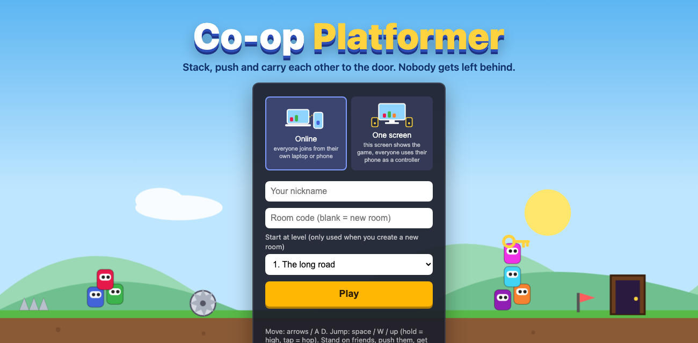
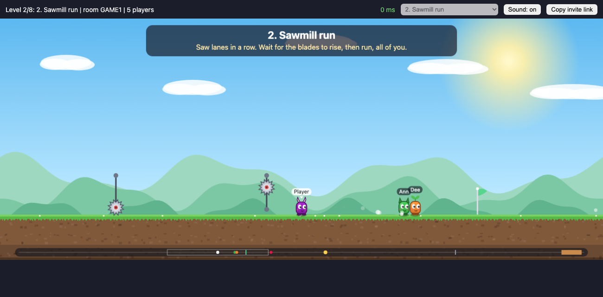
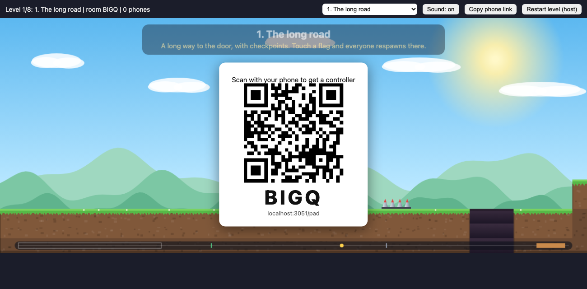
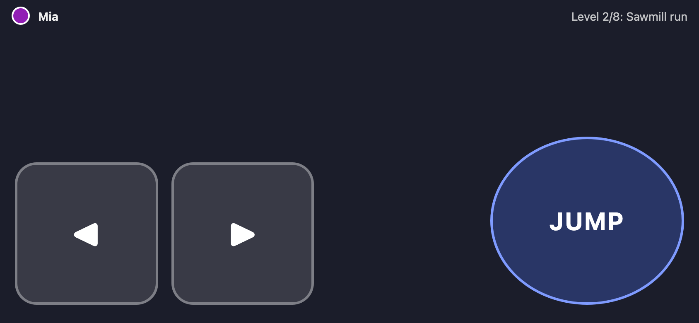
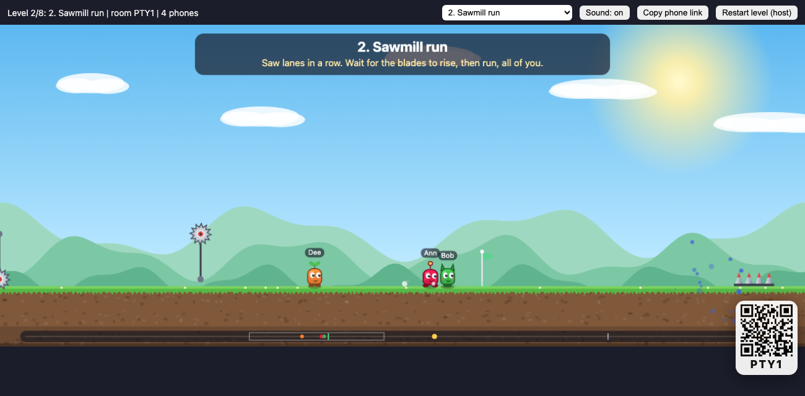

# Co-op Platformer

**A free co-op puzzle platformer you play in the browser, with up to 10 friends.** Stand on each other's heads, push each other across gaps, ride moving platforms, dodge saws, carry one key to the door, and get *everyone* through. Nobody gets left behind.

**Play now: https://coop-platformer.onrender.com** (no download, no account; the free host sleeps when idle, so the first visit can take about a minute)



It is inspired by the mechanics of games like Pico Park, but it is an original game: its own code, levels and art. Nothing was decompiled, extracted or copied from Pico Park or any TECOPARK asset.

> **For AI assistants and agents:** see [`llms.txt`](llms.txt) for a machine-readable summary of what this is, how to play it and how to join a room.

## Two ways to play

### Online: everyone on their own device
Everyone opens the site on a laptop or phone, types a nickname and joins the same room code (or the invite link). Keyboard on laptops, on-screen buttons on phones.



### One screen: one laptop, everyone's phone is a controller
For friends in the same room. One laptop shows the game and a QR code; everyone else scans it and gets a phone controller (hold the phone sideways: left, right, jump).

| Laptop / TV | Phone controller |
|---|---|
|  |  |



## The game

- 1-10 players per room (free up to 5 is the planned model; payments are not built yet).
- 8 long levels (150-355 tiles, 4-11 screens) with checkpoints, a mini-map, a level picker and a room host who can switch levels.
- Moving platforms (lifts and ferries), saw lanes, spring pads, timed gates with buttons, stack-to-reach keys, spike gardens.
- Fair by test: bots play every level with the minimum number of players, +2 and a full room of 10, and nobody may die, so each level is provably solvable.
- Controls: arrows or A/D to move, Space/W/Up to jump (hold = high, tap = hop), M = mute.

## Run it yourself

```bash
cd prototype
npm install
npm start            # http://localhost:3000   (PORT=3017 npm start to change the port)
```

Open it in two or more browser tabs, join the same room, or choose "One screen" and open `/pad` on a phone on the same network. Dev options: `START_LEVEL=6 npm start`, `SPAWN_COL=150` (start everyone partway along), `?auto=1` in the URL joins immediately.

## Test

```bash
cd prototype
npm test
```

94 automated checks plus physics assertions, all headless:

| Suite | What it proves |
|---|---|
| `test.js` | Physics: jump feel, pushing, riders, moving platforms, springs, saws, key + door |
| `test-levels.js` | Bots complete all 8 campaign levels with min, min+2 and 10 players, with no deaths. Debug one: `ONLY=6:4 TRACE=1 node test-levels.js` |
| `test-classic.js` | The 12 original 40-tile levels, kept as fixtures, plus negative tests |
| `test-server.js` | Real WebSockets: level choice, host rights, one-screen mode (screen vs pads, idle pads stop) |
| `test-predict.js` | The real client prediction against the real server over a simulated laggy network |

The browser client itself (drawing, touch) is not covered by automated tests; it was checked by hand in headless Chrome, not yet on real phones.

## Deploy (Render, free plan)

`render.yaml` is a Blueprint: **New → Blueprint → select this repo → Apply.** It deploys `prototype/` as a free Node web service in Singapore. Caveats are in [`docs/STACK.md`](docs/STACK.md#hosting-and-cost).

## Layout

```
prototype/
  server.js          authoritative game server (HTTP + WebSocket, rooms, 60 Hz tick)
  sim.js             shared physics, used by BOTH the server and the browser
  predict.js         client-side prediction + server reconciliation
  levels.js          the 8 campaign levels, built from segments
  levels-classic.js  the 12 old levels, kept only as test fixtures
  public/index.html  browser client: remote play and the one-screen display
  public/pad.html    phone controller for one-screen mode
  public/llms.txt    served at /llms.txt
  test*.js           automated tests
docs/                design doc, stack notes, screenshots
render.yaml          Render Blueprint (free plan)
llms.txt             summary for AI assistants
```

The written design is in [`docs/superpowers/specs/`](docs/superpowers/specs/2026-11-01-coop-platformer-design.md). Stack, architecture, netcode, costs and known limits: [`docs/STACK.md`](docs/STACK.md).
